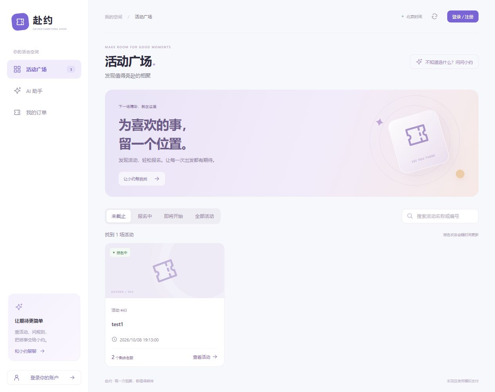
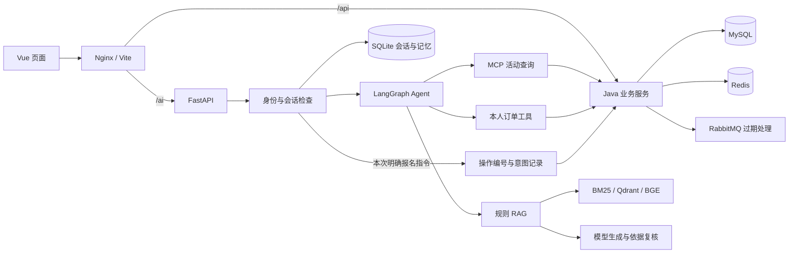

# 赴约 · Gather AI Agent

一个面向活动报名场景的**个人项目**。以 Python AI Agent 为交互入口，结合 Java 后端完成规则问答、活动查询、本人订单查询与明确指令报名，提供 Vue 页面展示与操作。

项目重点是把模型接入真实业务：规则回答需要可核对的依据，实时状态来自业务接口，报名写入需要明确授权、稳定操作编号和数据库事务。



## 功能

- **Agent 工作流**：LangGraph 编排规则问答、业务查询、混合问题拆分与澄清，Pydantic 校验结构化输出。
- **MCP 工具**：通过 stdio MCP 接入公开活动列表与详情；本人订单、报名工具绑定已验证的用户身份。
- **RAG**：BM25 + BGE 向量检索，RRF 融合，BGE Cross-Encoder 重排；Qdrant 本地持久化并按内容版本管理索引。
- **回答校验**：检查原文引用、结论依据和问题覆盖；资料不足、引用异常时拒绝给出未经支持的业务结论。
- **上下文与记忆**：用户/会话隔离，近似 Token 预算选择完整轮次，带来源的历史原话摘录，用户级表达偏好。
- **可靠报名**：原始明确指令触发写入；前端保留操作编号，Python 保存操作意图，Java 事务维护操作与订单映射，成功操作重试返回原订单。
- **Java 业务**：JWT 登录鉴权、活动发布、名额扣减、有效订单唯一约束、模拟支付、取消与过期关单。
- **缓存与消息**：Redis 空值缓存、TTL 抖动、单进程请求合并、提交后缓存失效；RabbitMQ TTL/死信触发订单过期，数据库扫描兜底。
- **Vue 页面**：活动时间筛选与搜索、聊天卡片和引用展示、本人会话恢复、订单管理、管理员活动表单。

## 技术栈

| 层次 | 技术 |
| --- | --- |
| AI 服务 | Python 3.12、FastAPI、LangGraph、Pydantic、MCP、DeepSeek API |
| 检索 | Qdrant、BM25、BGE Embedding、BGE Reranker、PyTorch/CUDA |
| 业务服务 | Java 17、Spring Boot、MyBatis、Spring Security/JWT |
| 存储与消息 | MySQL、Redis、RabbitMQ、SQLite |
| 前端 | Vue 3、Vite、Nginx |
| 工程 | uv、Maven、Docker Compose、k6 |

## 架构与请求流程



1. Java 验证 Bearer token，Python 先检查会话是否属于当前用户。
2. 普通消息经过历史选择、追问补全和意图检查，再进入 Agent 路由。
3. 规则问题走 RAG；活动与订单当前状态走业务接口；混合问题分别处理后合并。
4. 明确报名跳过模型改写，保留同一 `operation_id` 执行；超时或结果未知时使用原编号恢复。
5. Vue 将结构化结果渲染为简短摘要与卡片；引用原文、更多结果按需展开。

详细设计见 [架构说明](docs/architecture.md)，测试范围见 [验证说明](docs/verification.md)。

## 目录

```text
ai-service/
  assistant_api/       # Agent、RAG、身份、会话、记忆与业务工具
  knowledge/           # 业务规则知识
  tests/               # 模拟模型/Java 的回归检查
  business_mcp_server.py
  main.py
app/                   # Java 业务接口、事务与消息处理
db/                    # 建表脚本
frontend/              # Vue 页面与同源代理
load/                  # k6 并发验证脚本
docs/                  # 架构、运行与验证说明
compose.yaml
.env.example
```

## 本地运行

### 1. 环境

- 已验证环境：Windows、Docker Desktop、Java 17、Node.js 24、Python 3.12 与 uv。
- AI 检索服务当前要求可用的 NVIDIA CUDA GPU。Embedding 与 Reranker 在本机推理，未做 CPU 回退。
- 首次需要下载 Python/npm 依赖、容器镜像与 BGE 模型；普通 AI 问答需要自备 DeepSeek API key。

### 2. 配置

```powershell
Copy-Item .env.example .env
```

填写 `.env` 中的数据库、RabbitMQ、JWT 和 DeepSeek 配置。仓库不提供预置账号或可用密钥。

JWT 使用至少 32 个随机字节的 Base64 编码值，可在本机生成后填入 `JWT_SECRET`：

```powershell
python -c "import base64,secrets; print(base64.b64encode(secrets.token_bytes(32)).decode())"
```

### 3. 启动业务服务与页面

```powershell
docker compose up -d --build
```

访问页面 `http://127.0.0.1:8080/`，注册个人测试账户后登录。新数据库默认没有活动。

需要发布活动时，先注册一个本地管理账户，再在自己的测试数据库中授予该账户管理员角色，重新登录后使用活动管理页面：

```sql
UPDATE users SET role = 'ADMIN' WHERE username = 'your_admin_name';
```

初始化 SQL 仅在新建 MySQL 数据卷时自动执行；已有数据库需按自身版本执行迁移。不要为更新代码删除已有数据卷。

### 4. 启动 AI 服务

另开终端，在 `ai-service` 目录执行：

```powershell
uv sync --python 3.12
uv run python -c "from huggingface_hub import snapshot_download; snapshot_download('BAAI/bge-small-zh-v1.5'); snapshot_download('BAAI/bge-reranker-base')"
uv run uvicorn main:app --host 127.0.0.1 --port 8000
```

等待模型加载完成后，在网页的 AI 助手中提问。Python 服务在本机运行；Docker Desktop 中的 Nginx 通过 `host.docker.internal:8000` 访问它。当前 Compose 没有容器化 Python/GPU。

本地排查入口：

- AI 健康检查：`http://127.0.0.1:8000/health`
- FastAPI 文档：`http://127.0.0.1:8000/docs`
- Java 活动列表：`http://127.0.0.1:9091/events`

前端开发模式：

```powershell
cd frontend
npm ci
npm run dev
```

### 5. 使用示例

```text
没过期的活动发出来
待支付订单超过付款时间会怎样？
已经支付的呢？
查看我的订单
以后回答简洁一点
```

报名需使用真实活动编号，例如“帮我报名活动<编号>”。网页为新的报名请求生成操作编号；待确认请求通过原编号手动重试。支付和取消在“我的订单”页面进行。

## 验证

Python 检查使用临时 SQLite、模拟模型与业务接口，不调用付费模型：

```powershell
cd ai-service
uv run python tests/check_chat_booking.py
uv run python tests/check_memory.py
uv run python tests/check_context_budget.py
uv run python tests/check_event_listing.py
```

前端检查与构建：

```powershell
cd frontend
node tests/check_assistant.mjs
npm ci
npm run build
```

Java 集成测试需要自己的测试数据库、Redis、RabbitMQ 和 `.env` 配置：

```powershell
cd app
.\mvnw.cmd test
```

k6 脚本通过 `BASE_URL`、`LOAD_ADMIN_USERNAME`、`LOAD_TEST_PASSWORD` 传入测试环境配置，不在代码中保存口令。测试会创建测试账户、活动和订单，请在专用本地环境执行。

## 当前边界

- 个人实践项目，不代表生产环境运行规模或商业服务 SLA。
- 是单 Agent 的状态图编排，未训练或微调大模型。
- 知识库和检索样本规模有限，引用校验与模型复核不能保证所有回答都正确。
- 当前报名支持有限的明确指令；没有定时抢票、聊天支付取消或真实支付平台。
- 近似 Token 预算与有界历史摘录不保证保留全部重要历史。
- 前端待确认报名仅保证同站点、同标签页刷新恢复，不保证关闭标签页或跨设备恢复。
- Redis 请求合并限于单进程；消息消费异常依靠数据库扫描兜底，不是完整重试体系。
- 默认端口仅绑定本机，当前运行说明以本地演示为目标。
